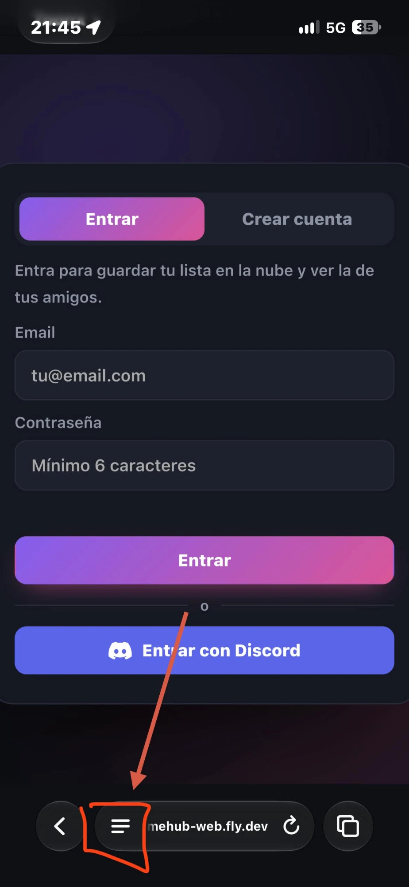
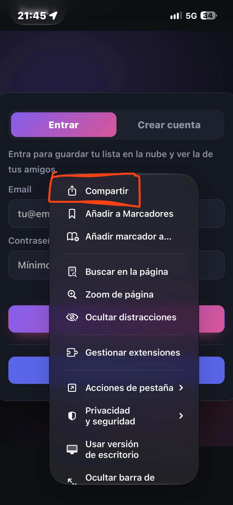
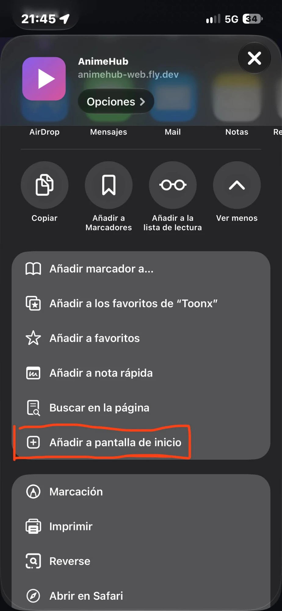
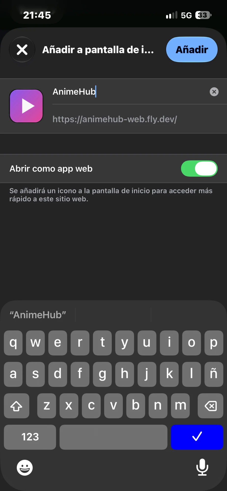

# AnimeHub

Descargas de **AnimeHub** para Windows y Android, y versión web para iPhone.

**[⬇ Ir a la última versión](https://github.com/Rassher/animehub-releases/releases/latest)**

## Windows

1. Baja el archivo `AnimeHub-Setup-x.y.z.exe`.
2. Si Windows avisa de «editor desconocido», pulsa **Más información → Ejecutar de todas formas**.

## Android

1. Baja el archivo `AnimeHub-x.y.z-arm64-v8a.apk`, que vale para casi todos los móviles. Si al instalarlo dice «no es compatible», usa el que acaba en `universal`, que vale para cualquier móvil.
2. Ábrelo desde el móvil.
3. Cuando lo pida, permite **instalar apps desconocidas** desde la app con la que lo hayas abierto (el navegador o Archivos).

Una vez instalada, la app se actualiza sola. En Android, si estás con datos móviles, te pregunta antes de descargar.

## iPhone

En el iPhone no se instala nada: AnimeHub funciona desde el navegador y se añade a la pantalla de inicio como una app más.

1. Abre **https://animehub-web.fly.dev** y pulsa el botón de menú junto a la dirección.
2. Pulsa **Compartir**.
3. Baja y pulsa **Añadir a pantalla de inicio**.
4. Deja activado **Abrir como app web** y pulsa **Añadir**.

Ya tienes el icono de AnimeHub en la pantalla de inicio: se abre a pantalla completa, sin la barra del navegador. Inicia sesión con tu cuenta de AnimeHub o con Discord; tus listas y Ver juntos son los mismos que en el PC y Android.

| 1. Menú | 2. Compartir | 3. Añadir a pantalla de inicio | 4. Añadir |
|---|---|---|---|
|  |  |  |  |

Si tarda unos segundos en abrir la primera vez después de un rato sin usarla, es normal: el servidor se estaba encendiendo.
